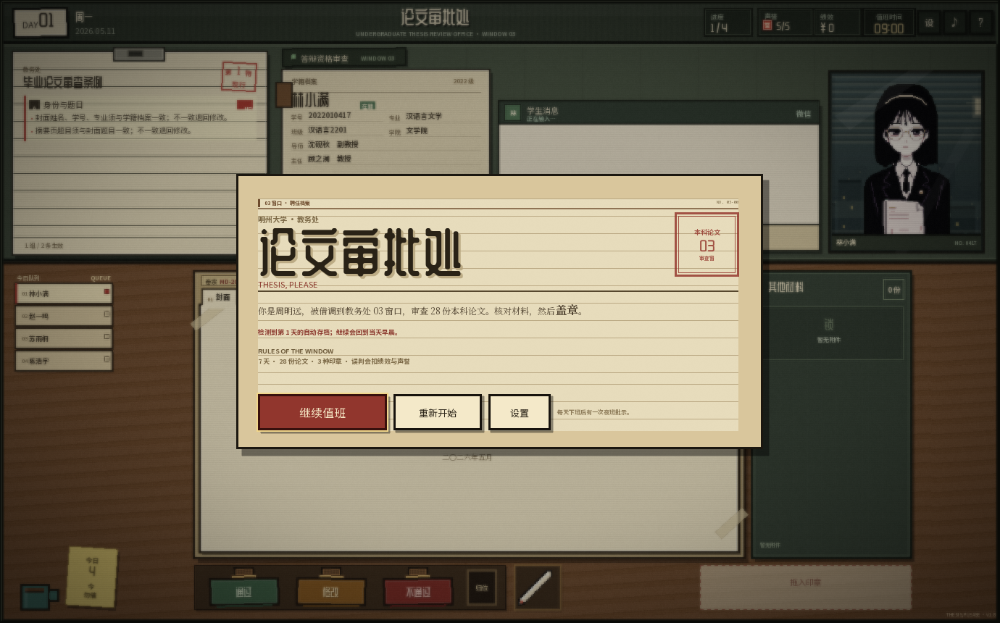
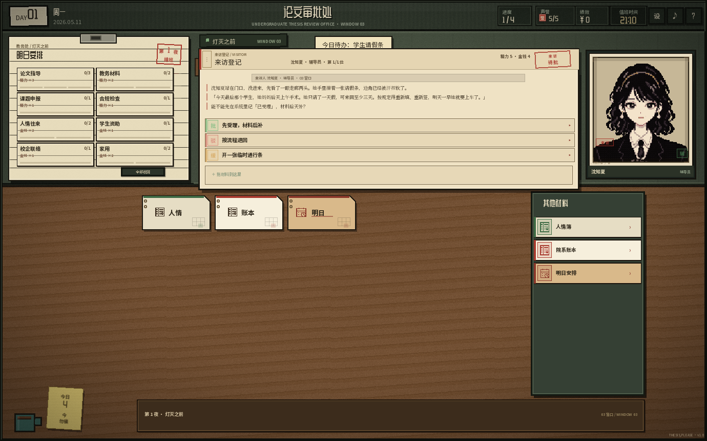

# 论文审批处 / THESIS, PLEASE — Godot 复刻版

把 `thesis-please.html` 单文件网页游戏 **1:1 尽量复刻** 成的 Godot 4 项目。

## 下载 / Download

- **Windows x64 便携版**：[Latest Release](../../releases/latest)（单文件 `THESIS_PLEASE.exe`，免安装）
- 系统：Windows 10/11 x64；OpenGL 3.3；窗口 1380×860，可缩放。
- 存档：Godot `user://`，Windows 下位于 `%APPDATA%\Godot\app_userdata\thesis_please`。
- 关闭游戏后可直接删除文件夹；不写注册表。

常用键：`F` 人情簿、`C` 学院账本、`L` 值班日志、`H` 帮助、`G` 设置、`M` 音效、`Esc` 关闭纸窗。




## 玩法 / Features

- 7 天、28 份论文、12 个当面材料包；核对材料 → 盖章 → 夜班 → 排班 → 来访。
- 6 次精力/金钱分配、8 个项目、9 次来访；人情簿、学院账本、感谢函、通行条。
- 纸质来访登记、材料批注/盖章/归档、值班日志、七天人账、多结局。
- 所有纸窗可拖动，带 `⋮` 纸角把手、吸附与位置记忆。

## 从源码运行 / Build

需要 Python 3.12、Node.js 和项目内便携 Godot：

```powershell
python -X utf8 tools/project.py setup    # 首次：安装 Godot / 导出模板
python -X utf8 tools/project.py test     # 完整测试
python -X utf8 tools/project.py release  # 完整测试 + Windows exe
```

- 逻辑分辨率：**1380 × 860**（与原版 `.screen` 一致，窗口按比例缩放）
- 引擎：**Godot 4.7.2**（GL Compatibility，Windows 上已验证）
- 原始基准：`reference/thesis-please.snapshot.html`（**v1.8**，2026-10-17 22:00，SHA-256 `BEC81E…9C718D`）
- 旧版基准留档：`reference/thesis-please.v1.4.html`
- 原 HTML 文件未被修改。

## 授权 / License

代码使用 **MIT**（见 [LICENSE](LICENSE)）。原案、剧情、角色与视觉设定来自项目所有者提供的 `thesis-please.html`，不随 MIT 重新授权；第三方字体与引擎说明见 [NOTICE.md](NOTICE.md)。

## 结构优化与统一工作流（2026-10-19）

已集中运行状态、统一文件窗口管理、拆分编辑器模块，并提取文件窗口、聊天面板与材料卡场景。
Python 和编辑器共用字段结构及有效/无效样例；保存、发布前都做校验。
测试使用独立存档目录，构建不再隐式依赖仓库外的引擎。

```powershell
python -X utf8 tools/project.py setup    # 新电脑：安装项目内便携引擎与模板
python -X utf8 tools/project.py build    # 内容编译
python -X utf8 tools/project.py test     # 完整测试与 PCK 冒烟
python -X utf8 tools/project.py release  # 完整验证后导出 Windows exe
```

依赖 Python 3.12 与 Node.js；详细职责、场景入口、配置和迁移方式见 [项目结构与维护入口](docs/ARCHITECTURE.md)。
继续游戏保持“当天早晨”的存档语义；固定/并排窗口接口已准备好，尚未增加相应按钮。
以下各版本记录保留历史背景，当前结构与命令以架构文档为准。

## v1.26 / 修复开局公告按钮无法点击

- **根因**：`PaperWindow` 的 `⋮` 把手原本是弹窗 `PanelContainer` 的子节点，被容器拉伸成整张卡大小并设置 `mouse_filter = STOP`，把“开始值班 / 开始审查 / 设置”等按钮全部盖住。
- **修复**：把手改挂到外层 `modal_loose` / `modal_top`，用 `item_rect_changed` 跟随卡片位置；只占纸角 20×22，不再参与卡片布局。
- 新增 `startcheck`：标题“开始值班” → 每日通告“开始审查” → 断言进入 `review`。
- 截图 `151`–`155`；说明 [V1.26-NOTES.md](docs/V1.26-NOTES.md)。

## v1.25 / 纸质窗口、值班日志、材料批注/归档、复访

- **通用 PaperWindow**：设置、帮助、日志、回执等纸质弹窗统一可拖，带 `⋮` 把手、边缘吸附、位置记忆、Esc 关闭；请求包/附件补置顶压暗与松手吸附。
- **值班日志**：来访批办、排班自动写入 `RunState.duty_log`；分配界面“值班日志”按钮或 `L` 打开；按天显示批/驳/缓、绩效、人情。
- **周报/多结局**：第 7 天“七天人账”汇总；结局新增停职调查、学院清算、人情网，再落到长聘/续聘/留用/解约。
- **材料批注/盖章/归档**：材料展开底部可手写批注、盖已阅/缓办/驳回、归档/取回；卷宗模式只显示归档材料；批注会进来访登记单。排班完成时还会核对人情簿与院系账本，差 ≥5 生成“对账”日志。
- **复访**：同一角色再出现时带上次回执与批注；现有沈知夏、系主任重复来访。
- v1.24 的全局宋体/Times 实验已撤回，字体仍为 v1.23 的 ZCOOL/Noto 混排。
- 截图 `151`–`155`；说明 [V1.25-NOTES.md](docs/V1.25-NOTES.md)。

## v1.23 / 来访登记回到纸质窗口，可拖动

- **取消来访消息的仿微信设计**：不再用深色微信头、头像气泡和“微信”字样；来访重新是一张纸质登记单——红装订线、`来访登记 / VISITOR`、红框“来 访 / 待 批”、带红色左线的陈述段落、纸面拟办行、纸面附件条、纸面回执。
- **窗口可拖动**：顶部 `⋮` 把手/标题栏可拖动整张纸，限制在屏幕内；拖开后露出的是原木桌，不是学生档案/学生微信。
- 无访客时，原来的学生微信位也换成纸质“来访登记 / 暂无来访”小卡。
- 保留选项悬停后果卡、材料拖入提交、附件 × 取消、回执/下一位。
- 截图 `146`–`150`；说明 [V1.23-NOTES.md](docs/V1.23-NOTES.md)。

## v1.22 / 未展开只给外形，展开才看细节

- **不再单独做桌子/文件夹**：材料直接散在主游戏原本的木桌上拖动，排班时临时隐藏主游戏中央卷宗，收工后恢复；没有“桌上文件”大文件夹和内部小桌面。
- **未展开材料改成有辨识度的外形**：明日安排＝切角卡纸+装订孔+日历图标+「明日」；院系账本＝书脊+封面标签+松紧带+「账本」；临时通行条＝缺口票据+虚线撕口+存根+「通行」；人情簿＝深绿书脊账本+「人情」；感谢函＝信封+火漆+「感谢」。小卡不再写材料类型、编号、材料签、总人数等小字。
- 右侧“其他材料”目录同步减法：只剩纸样色条、图标、完整标题、`›`。
- **展开页重排**：抬头字号加大；人情簿 7×23、院系账本 6×24、明日安排 2×4/42、感谢函/通行条 9.5 正文，横线与文字基线重新对齐。
- 新增 [MaterialShell.gd](scripts/MaterialShell.gd)；截图 `141`–`145`；说明 [V1.22-NOTES.md](docs/V1.22-NOTES.md)。

## v1.21 / 来访登记不再弹窗，整段交流放大到来访消息里

- **去掉来访登记弹窗**：来访者陈述、来意、三条拟办、附件、回执全部放进一块 **741×274** 的 `VisitorChat` 面板；面板覆盖原档案卡与微信位，不动项目书和来访者肖像。
- **选项后果只在悬停时显示**：鼠标移到 `批/驳/缓` 行，面板左侧弹出 **320px 自定义深色提示卡**，分“人情 / 收支 / 随附 / 附赠”列出后果，不再用系统灰 tooltip；项目卡/材料卡/文件卡的默认 tooltip 一并清掉。
- **材料拖进消息面板提交**：`DeskItem` 的拖动坐标交给 `AllocationView`，整块来访消息都是投放区；拖入后材料卡回原位，附件栏出现材料 chip，右侧 `×` 可取消。一次一份，再拖一份会替换。
- **回执也在消息里**：选完后消息区显示回执正文、人情/收支摘要和“下一位/去排班”按钮，不再开第二个弹窗。
- 测试新增 `visitorcancel`（拖入→×→无附件结算）；截图 `136`–`140`；说明 [V1.21-NOTES.md](docs/V1.21-NOTES.md)。

## v1.20 / 去掉碍眼提示，换掉纸片人像

- **删除“今晚流程”整块面板**；排班时同时隐藏主游戏的“今日队列”、印章托盘、裁决条与批注板，左侧只留木桌与咖啡/便签，不再挂着操作说明，也不再露出“拖入印章”。
- 清掉项目书/文件夹/材料架/文件小卡/档案卡/登记单/底部横条上的常驻提示；只保留按钮、状态与鼠标悬停 tooltip。底部横条只显示“第 N 夜 · 灯灭之前”和“03 窗口 / WINDOW 03”。
- **来访者不再是纸片人**：复用主游戏已有的手绘学生肖像，裁成 186×204 登记照片——纸相框、四角固定、暖色照片调、边缘压暗、左下“来访”红章、右下角色印、`VISITOR / 03` 编号；角色有固定肖像映射。没有访客时只留空相框和“等待来访”。
- 左侧来访登记单内容放入滚动区，高度压到 470，去掉底部空白；回执仍是短卡。
- 截图 `132`–`135`；说明 [V1.20-NOTES.md](docs/V1.20-NOTES.md)。

## v1.19 / 道具文件也做“材料”特质

- **明日安排 / 院系账本 / 临时通行条**（连同人情簿、感谢函）统一成主游戏“补充材料”的语言：纸样（`CARDSTOCK` 卡纸、`SEALED` 密封、`CARBONLESS` 无碳、`LEDGER` 账本、`MIMEO` 油印）、材料线稿图标（日历/账本/票据/信封）、材料编号（M-01…M-05）、材料色条和红色“材料”小签。
- 三处统一：桌面 136×70 小卡、右侧 198×46 “其他材料”目录、展开后的 460×212 文件抬头；目录点击仍直接展开桌面文件。
- 数据只补 `style/icon/stock/stock_cn`；老存档缺字段时由 `PropMaterial.traits(kind)` 回退，不需要迁移。顺带修正人情簿/院系账本/明日安排展开页正文的深墨对比度。
- 新增 [PropMaterial.gd](scripts/PropMaterial.gd)；截图 `121`–`124`；说明 [V1.19-NOTES.md](docs/V1.19-NOTES.md)。

## v1.18 / 灯灭之前直接套用主游戏界面

- **版式复用主游戏**：审查条例的位置换成“明日安排”项目书（8 项 2×4），学籍档案的位置换成“排班档案/预算卡”；下面的卷宗纸张变成桌上文件，右侧“其他材料”架变成文件目录，学生肖像换成来访者肖像，学生微信换成来访消息，左侧队列换成今晚流程，底部印章台换成排班提示条。
- **项目书**：每张 150×45 小纸卡显示名称、硬币/上限、已排/上限、进度；左键放、右键取；悬停显示说明与效果；全部收回仍在标题旁。
- **文件**：中央文件夹里仍是 `DeskItem` 纸卡（人情簿/院系账本/明日安排/感谢函/通行条），可拖动、点开、收起；右侧目录同步列出，点击展开。
- **访客**：来访者直接出现在主游戏肖像窗（216×253）；微信面板复用为来访消息；“来访登记与拟办单”变成左侧紧凑弹窗，不再重复肖像和长陈述，右侧微信/肖像保持可见。
- **版本关系**：v1.17 的“上方排班板+下方桌子”（109–112）是过渡版，已被本版取代；道具文件/随附文件/存档 items 保留，存档仍为 v5。
- **测试**：`allocationcheck`/`deskclick`/`visitorclick`/`visitoritemclick`/`visitorpass`/`visitorconsume`；全量 `test --skip-shots`、`shotregress`；截图 `113`–`119`。
- 设计说明：[`docs/V1.18-NOTES.md`](docs/V1.18-NOTES.md)。

## v1.17 / 灯灭之前的桌子、道具文件与访客肖像

> v1.18 已把这一版的全宽排班板+下方桌子改成直接套用主游戏版式；本节的 `109–112` 截图保留为过渡记录，当前界面以 `113–119` 为准。

- **排班板 + 桌子**：明日安排改为 4×2 项目框，下方新增与主游戏同风格的木纹桌面；右侧固定人情簿/硬币托盘移除，预算与“全部收回”收进排班板标题行。
- **道具文件**：人情簿、院系账本、明日安排、感谢函、临时通行条都变成桌上的 `DeskItem` 纸卡；可拖动、单击展开成纸面、点“收起”折回，多份可同时展开。
- **人情簿不再占硬空间**：`F`/`C` 在灯灭之前展开桌上文件；审查阶段仍可打开原来的全屏账本弹窗。
- **访客肖像**：新增程序绘制的纸质占位肖像（78×106），按角色换色条/印章；后续可直接替换真实立绘。
- **随附文件**：来访单新增“随附文件（可选）”，可从 `RunState.items` 选一份递交；对方人情 +1、绩效 +20（感谢函 +2/+40），感谢函/通行条一次性消耗，簿子/账本/日程可复用。
- **存档**：`items` 进入每日快照；仍是 v5，旧档缺字段时自动补三份基础文件。
- **测试**：`allocationcheck`/`savecheck`/`backupcheck`/`continuecheck`；开发态 `deskclick`（展开/收起/拖动）、`visitoritemclick`（点纸片→拟办→+3 人情/+20 绩效）、`visitorpass`（“缓”生成通行条）；全量 `test --skip-shots` → `CHECKS PASSED`（含 `export.pck` / `pck-smoke`）；`autoweek` 第 7 天结局，绩效 8735；`shotregress` 通过（title/settings/request 基线不受桌子/来访改动影响）。
- 设计说明：[`docs/V1.17-NOTES.md`](docs/V1.17-NOTES.md)。截图：`109`–`112`。

## v1.16 / 左键放入、右键取回、字体补齐与材料化弹框

- **明日安排改交互**：左键点项目框放一枚，右键点项目框取回；不用再先点精力/金钱硬币，托盘只显示预算与剩余。`1`/`2` 选硬币已移除。
- **字体补齐**：旧字体子集只覆盖 v1.13 文本，v1.14/v1.15 新增文字有 291 个字缺字形。用 Noto Sans/Serif 可变字体、SimKai 和完整 ZCOOL 生成 fallback；六组字体对 1224 个 CJK 字符的覆盖均为 **0 uncovered**，标题/访客名/硬币缺字保持像素风格。
- **来访登记单**：来访选项不再是大按钮，而是一张带“来访人/单位职务/时间/窗口/事由”字段、“来访人陈述”“来意”“拟办意见”的表单；三个选项是带空心方框和“批/驳/缓”章的拟办行，结果页为同一抬头的“来访回执”。
- **去掉滚轮百分比**：材料窗口底部不再显示“滚轮翻页 0% / N%”浮层，长材料仍可直接滚轮翻页。
- **材料皮肤**：`_skin_card()` 给标题/通告/说明/设置/投诉/打卡/停职/结局/人情簿/院系账本/来访分别换上档案、红头通知、便签、蓝灰表单、打卡单、黑底通知、账本等纸面；顶部有材料名与档案号。
- **测试**：`allocationcheck` 加右键取回；`visitorclick` 验证拟办行点击；`requestcheck`/`requestflow`/`requestmulti`/`requestpacketcheck` 验证去百分比后的材料窗口；全量 `test --skip-shots` 与 `pack` 通过；`shotregress` 已重建标题/设置/材料窗口基线。
- 设计说明：[`docs/V1.16-NOTES.md`](docs/V1.16-NOTES.md)。截图：`98`–`107`。

## v1.15 / 学院导师、系主任与“通过”奖励

- **24 个学院归并为 6 个学部**：人文与传播、社会科学、理学、工学、艺术、医学。每个学部有自己的**指导老师（导师）**和**系主任（主任）**，不再让所有学生共用“周明远”。
  - 人文：沈砚秋 / 顾之澜；社科：梁思远 / 韩正清；理学：苏瑾 / 方立诚；工科：陈国栋 / 赵承宇；艺术：林墨 / 周岚；医学：陆明诚 / 何嘉仁。
- **档案与文件按学院填充**：学籍档案新增“主任”一行；论文封面、开题报告、导师意见、资格审查表的导师/系主任签字、请假条与优毕推荐表里的 `{{advisor}}` 都读学生所在学部。
- **通过奖励**：盖“通过”时，该学生学部的导师、主任各 +1 学院人情；**规范通过**额外给学院回礼（+¥25～40，按学部），规范通过满 **2 位**再给一次满额回礼（+¥70～120）并寄出一封**感谢函**。
- **误判放行**：学院也会记情，但拿不到回礼、不累计规范通过；玩家仍然吃 −¥80、声誉 −1 和投诉单。人情和判得对不对继续是两条线。
- **学院关系账本**：`C` 或人情簿底部“学院关系”打开；显示 6 个学部的导师/主任人情、规范通过进度、下一次回礼、上次通过的学生和最近往来。
- **感谢函**：满 2 位规范通过后，当夜文件架多一个“04 感谢函”页签，正文写学生、学部、导师/主任落款和回礼金额。
- **存档 v5**：`college_favor`、`college_log` 进入每日快照；旧档迁移为空学院账本。
- **校验**：`college_errors()` 校验学部/学院覆盖、学生导师/主任/学部字段、28 份资格审查表签字；Python 与编辑器编译器同步输出新字段。
- **测试**：新增 `--state=collegecheck`（24 学院覆盖、档案显示、一次真实通过、满 2 位回礼、感谢函不重复、存档往返）；`shotregress` 通过。
- 设计说明：[`docs/V1.15-NOTES.md`](docs/V1.15-NOTES.md)。

## v1.14 / 灯灭之前：精力/金钱分配、来访剧情与人情簿

- **新阶段**：每天的夜班之后、次日通告之前，进入“灯灭之前”。把当天的**精力**与**金钱**硬币放进八个项目框，处理上门的来访者，然后进入下一天。第 7 天夜班后直接结局，一局共 **6 次**分配。
- **硬币与项目**：精力上限 7、金钱上限 6；基础预算按夜从 5/4 递减到 4/3，人情加成可以补回。八个项目：论文指导、教务材料、课题申报、合规检查、人情往来、学生资助、校企联络、家用；左键点框放入、右键点框取回、全部收回，硬币放完才能收工。
- **七类新角色**：教务处主任吴敬之、教学副院长郑国栋、教导主任郝立本、同事林嘉树、辅导员沈知夏、校外企业招聘人员许明辉、学生。来访卡用“来访登记 + 角色印章”，不复用学生立绘。
- **9 次来访剧情**：第 1 夜辅导员；第 2 夜同事 + 学生；第 3 夜教务处主任；第 4 夜教导主任；第 5 夜领导 + 企业；第 6 夜学生 + 主任。每次 2—3 个 `批 / 驳 / 缓` 选项，消耗同一份精力/金钱，改变不同角色的人情、绩效与声誉。
- **人情系统**：每个角色 0—10，分生疏/点头/熟络/交心/过命五档；门槛给每周硬币或每次排班的绩效。来源覆盖分配项目、来访选择、正确盖章、误判、行政待办、微信回复与夜班批示。按 `F` 打开人情簿；下班单显示今日人情，结局列出整周人情簿。
- **存档 v4**：`favor`、`favor_log`、`alloc_log` 进入每日快照；旧档迁移后为空簿。
- **内容与校验**：`content/world.json → allocation` 为唯一内容源，`content_tools.py` 新增 `allocation_errors()` 与 `ALLOCATION` 编译映射；待办的 `favor` 写在 `tasks.json`，夜班选项的 `favor` 写在 `world.json`。编辑器 `WORLD_MAP` 同步。
- **测试**：新增 `--state=allocationcheck`（7 角色 / 8 项目 / 6 夜 / 9 来访、预算与加成、来访结算、硬币与绩效、存档往返、人情上下限）；`requestcheck` 增加待办人情断言；`autoday` / `autoweek` 接入自动分配。
- 设计说明：[`docs/V1.14-NOTES.md`](docs/V1.14-NOTES.md)。

## v1.13 / 文件式待办、13 种材料、条件链与模块化编辑器

- **待办绑定到队列**：12 份行政待办现在挂在具体的一天、一个队列位置上；只有该学生轮到窗口时才出示。未办结前盖章、下一位、下班都会被拦下。
- **新增三类事件**：D3 交换生项目（护照有效期不足 → 退回）、D5 实验室使用（安全培训/风险评估齐全 → 批准）、D6 名企实习推荐（实习期与答辩冲突 → 退回）。
- **学生材料就是文件**：奖学金/优毕/请假条不再是一张带 ✓/✗ 的表，而是多份可拖拽的学生材料。轮到学生时，申请表、成绩单、困难认定、班级公示一起进入右侧“其他材料”，点击或拖出打开纸张窗口，拖回材料架收起。
- **批准/退回在待办文件里**：材料包第一份（申请表/请假条/推荐表）是待办文件，底部有办理依据与批准/退回；其他材料窗口只负责阅读。没有新增独立待办面板。
- **13 种纸张**：原有 certificate / sealed / mimeo / carbonless / cardstock，加上 student_id 学生证、id_card 身份证、scholarship 奖学金证书、admission 录取通知、ledger 财务台账、index_card 档案卡、passport 护照页、boarding 登机牌；共用纸色、墨色、红章体系。
- **待办 UI**：队列增加“待”红标；右侧“其他材料”同时列当面材料与常备附件（可滚动），当面材料分组、常备附件分组、第一份带“待办”角标；长材料窗口可滚轮翻页，不再显示“滚轮翻页 N%”提示。
- **批准 / 退回字体**：待办文件底部按钮 16px 衬线粗体、2px 字距、128×44，支持 `A` / `R` 快捷键，Esc 收起；批准/退回有独立音效、Toast 与文件内局部落章。
- **信息清理**：材料卡不再显示纸张材质名；单字材料图标改为线稿图标（请假/就诊/成绩/公告等）；去掉“对话结束·可盖章”“归位 R”“或先点印章”“拖出查看/拖回即收”等提示。
- **模块化内容**：`content/` 拆成 world / characters / cases / levels / tasks 五个构建模块，外加编辑器侧 `logic.json` 条件链；人物名字、学号、专业、立绘统一维护，封面与查重身份由构建派生。
- **关卡编辑器**：`tools/level-editor/` 提供概览、关卡、人物、待办包、条件链、纸张样式、校验发布七个视图；支持拖拽队列、挂接待办、可视化条件链（比较/ALL/ANY/NOT、连线、缩放/平移/minimap、撤销重做、复制粘贴、自动布局、试算、错误标红）、学生消息 `line/chat` 与自定义对话树（说话人、每节点 1–4 个回复、回复指向后续分支）、13 种纸张缩略图、保存前 diff 与自动保存；材料编辑区可点缩略图直接换纸张。
- **构建工具**：`tools/content_tools.py` 提供 split / build / validate / check；`check` 已进入测试，确保 content 与 assets 不漂移。
- **测试**：新增 `facecheck`、`facefuturecheck`、`requestpacketcheck`、`stampcheck`、`stylecheck`、`eventcheck`；`requestcheck`、`requestflow`、`requestmulti`、`autoweek`、`inputreplay` 已按新流程调整。
- 设计说明：[`docs/V1.13-SOLUTION.md`](docs/V1.13-SOLUTION.md) · 发布记录：[`docs/V1.13-NOTES.md`](docs/V1.13-NOTES.md) · 新材料库：[`docs/V1.13-MATERIALS.md`](docs/V1.13-MATERIALS.md) · 新事件：[`docs/V1.13-EVENTS.md`](docs/V1.13-EVENTS.md) · 编辑器说明：[`tools/level-editor/README.md`](tools/level-editor/README.md)。

## v1.12 / 桌面点击、三类行政材料、攻略

- **修复夜班桌面点击**：`InputRouter.handle_mouse()` 之前只放行 `REVIEW/ANNOTATION`，`NIGHT` 被挡，导致文件标签/文件卡只能靠 `←/→`。现在夜班鼠标与主审查共用点击/拖动路径，标签和右侧“桌上文件”卡都可以左键打开。
- **立绘 v2 + grimoire shader**：28 张旧 72×88 立绘替换为 144×192 strict-style 胸像；03 窗口默认挂 `shaders/grimoire_bust.gdshader` 的 **01-soft** 档（`intensity=0.35`、`palette_mix=0.55`、`grade_strength=0.30`、`rim_strength=0` 等），设置里可开关；旧 CRT shader 保留为回退。原图 baked 白边用 `tools/strip_portrait_outline.py` 清掉，并用暗色剪影盖住抗锯齿残留；新交付无 blink 帧，`-blink.png` 用同图占位。
- **三类行政待办**：7 天共 9 份（奖学金 励志/国家/校级、优毕 院/校/省、请假条 1/3/7 天），申请人、论文题目和查重率来自当天队列学生；棉纸证书 / 牛皮卡纸 / 蓝色复写纸三种材质。
- **桌面纸**：待办不再走模态弹窗，而是**今日队列下面**的一叠纸（不同纸张纹理、回形针、层叠阴影）；点击放到桌面，拖纸角移动，批准/退回后盖章归档；未处理会挡住下班。正确 +¥40、错误 −¥40。
- **印章质感**：底部三枚印章加了木柄、铜箍、橡胶底和压印边缘；拖动时显示带错位墨影的印章幽灵，落章后是双线墨章、日期、干墨斑点。
- **大字号模式**：设置里新增 100% / 115% / 125% 字号，放大字体、行距和按钮高度，不依赖窗口缩放；仍保留独立“界面缩放”。
- **本地 playtest 指标**：可选写入 `user://session.json`，记录每名学生用时、圈空、问提示、投诉/重开、待办错误；只在本机，不上报。设置里可关闭。
- **轻度联动**：优毕推荐表会引用当天学生的论文题目与查重率，推荐表填报值和报告不一致时退回；奖学金/请假条也使用当天队列的申请人。
- **不同纸张材质**：`paper_certificate.png` / `paper_cardstock.png` / `paper_carbonless.png`，由 `MaterialPaper.gd` 选择纹理、边框、抬头和印章样式。
- **通关攻略**：[`docs/WALKTHROUGH.md`](docs/WALKTHROUGH.md)（含 7 天结论表、9 份待办答案、夜班选择、结局阈值）。
- 设计说明：[`docs/V1.12-NOTES.md`](docs/V1.12-NOTES.md)。

## v1.11 / 精简

- **移除案卷 / 证据链**：删除“案卷”按钮、`C` 快捷键、证据链 `+¥40`、投诉单/结局的证据链文案与测试；保留逐条锚点、圈注 +¥20、投诉单圈注回放。
- **移除学生态度系统**：删除信任值、配合/冷淡/不安、投诉单“学生态度”、结局按回复风格给短评；三选一仍保留“提示一次 / 不给提示 / 省 10 分钟”，学生下一句与夜班来信仍会不同。
- **存档精简**：不再保存 `chain_count / checklist_count / concern_count / desk_count`；旧存档由 `migrate()` 忽略这些字段。
- 设计说明：[`docs/V1.11-NOTES.md`](docs/V1.11-NOTES.md)。

## v1.10 / 维护性

- **测试出仓**：15 个 `--state` 与断言语义移到 `tests/TestMain.gd` / `tests/TestMain.tscn`，Main 从约 5000 行降到 **约 3500 行**；`export_presets.cfg` 排除 `tests/*`，发布包不再带测试代码。
- **输入路由**：新增 `InputRouter.gd`，把 TITLE / MODAL / REVIEW / ANNOTATION / NIGHT / GAMEOVER / ENDING 明确定义；`_input` 与 `_unhandled_input` 只做转发。弹窗打开/关闭主动 `release_focus()`，Enter 不再靠焦点巧合决定是盖章还是点按钮。
- **原子存档**：`save.tmp → save.bak → save.json`；读取失败自动回退 `.bak`，并新增 `migrate()` 兼容旧版本。
- **文本完整性**：`tools/check_text.py` 检查 UTF-8/BOM、U+FFFD、PUA 与 CP936 乱码特征，并对 Main.gd 的中文字符串做语料抽样。
- **只问一次**：微信状态改为“只能回复一次 · 提示仅一次”，悬停“最担心哪项？”会说明仅一次。
- **发布冒烟**：把 `SmokeCheck.gd` 留在发行版里，导出后的 exe 可跑 `--state=smoke`；CI 工作流 `.github/workflows/ci.yml` 负责下载 Godot/模板、跑契约与导出冒烟。
- **设计说明**：[`docs/V1.10-NOTES.md`](docs/V1.10-NOTES.md)。

## v1.9 / 条目级审查

- **逐条锚点**：参考文献每一条、资格审查表三个签字、伦理批号、学分、学费、正文页数/字数/缺页都成为独立锚点；圈注标签显示具体问题（如“第 7 条：百度百科”“缺系主任签字”“缺第 13 页”），不再只显示“参考文献不达标”。
- **差一点提示**：圈空时给出最近缺陷的方向与标签，而不是直接淡出；不奖励、不惩罚。
- **三选一取舍**：`按清单核对` 不给提示；`最担心哪项？` 给出最严重缺陷的具体标签，但每名学生只能问一次；`先放桌上` 省 10 分钟、学生不再补充。v1.11 起不再有信任值/学生态度。
- **证据链（v1.11 已移除）**：原先是圈注 + 微信提示 + 对应材料页三者对上，正确盖章额外 +¥40；当前版本保留逐条圈注、投诉单圈注回放与圈注准确率统计，不再计算证据链。
- **夜班邮件**：白天的微信回复会在夜班生成一封学生来信，引用学生说过的话；三种回复生成三封不同的信。
- **每天自动存档**：标题页“继续值班”，读档回到当天早晨；只存天、学生索引、绩效、声誉、夜班日志与统计，不存进行中的拖拽/聊天/圈注。
- **可访问性**：界面缩放 100/125/150%、减少震动/闪光、文字速度、键盘焦点与 Esc 关闭、音效设置；设置独立持久化。
- **音乐提示词**：见 [`docs/MUSIC-PROMPTS.md`](docs/MUSIC-PROMPTS.md)。
- **设计说明**：[`docs/V1.9-NOTES.md`](docs/V1.9-NOTES.md)。

## v1.8 / UI 优化

- **夜班剧情**：每天下班后进入“灯灭之后”，桌上出现 3 份夜班文件（小票、便函、便条、签收表、邮件、微信、PDF 等），翻阅后做一次夜间批示；7 夜选择进入结局日志。
- **材料架可拖动**：拖动材料架标题可重新摆位，双击标题或按 `R` 归位。
- **背景模糊 + 纸张卡片**：模态弹窗现在有屏幕空间高斯模糊、纸纹/内框/阴影；标题、通告、帮助、投诉、下班单、结局统一。
- **操作手感**：可点击元素手型光标、标签/材料卡悬停高亮、印章悬停、材料拖拽跟手 ghost、夜班文件支持 `←/→` 翻阅、`1/2` 批示、`Enter` 结束夜班。
- **夜班按钮放大**：原版两枚 43×30 的横排小按钮改为两枚 92×26 的全宽按钮，文字不再挤成 8px 小方块。

## 选中态 / 排版检查

对照原版 v1.8 选中态截图逐项修正：

- **卷宗标签**：非选中标签下沉 2px，选中标签向上 2px；选中标签底部有 5px 与纸面同色的接缝条（对应原版 `::after`），并且不再出现“标签侧边框插进纸面”的问题。标签编号与标题按基线对齐，不再一个居中、一个偏低。
- **印章**：三枚印章收进一个深色木盒，不再给每枚印章套独立外框、副标题或快捷键小字，只保留印章面的“通过 / 修改 / 不通过”。选中时印章整体上浮 2px，印章面换成奶油色描边，并在盒底出现 3px 奶油色衬线；未选中 hover 只轻微提亮，不和选中态混淆。
- **结论栏**：选中后边框/内描边/文字变成对应印章色；“盖「X」”与“点击或拖入”分成 11px / 9px 两行。未选中时显示“拖入印章 / 或先点印章”，不再是一句含糊的“点击盖章”。
- **材料架 / 夜班文件卡**：选中卡红色内嵌左条、红色图标、奶油底；图标、标题、说明改为纵向居中；选中卡 hover 不再变亮，避免把选中态冲掉。
- **字体一致性**：选中有无都使用同一字体/字号；仅目标提示的小字按主次改为 11px / 9px。
- **夜班标签/文件架**：复用同一套标签与卡片规则，底边接缝与选中红色内条一致。

截图：[21-selected.png](screenshots/21-selected.png)，原版/Godot 并排：[comparison-selected.png](screenshots/comparison-selected.png)。回归命令：`--state=selected`。

## 印章盒 / 微信消息 / 画圈 / 声誉

- **一个盒子三枚章**：印章区从三张带说明文字的卡片改成一只木盒，盒内直接放三枚可拖印章；没有逐枚外框，也没有“准予答辩 / 限期整改 / 学术不端”等副标题，横向空间还给桌面。
- **完整落章反馈**：点一下印章再松手，会明确提示“已选「修改」：点结论栏，或把印章拖到论文上”；拖歪松手提示“「修改」未盖下：拖到结论栏再松手”；拖到论文或结论栏才真正落章。提示框按实际字体测量宽度，不再被裁掉半句。
- **微信式学生消息**：原先单行学生陈述改成微信面板；学生头像、姓名、`正在输入…`、绿色/纸色气泡。问候、交材料、核对说明会自动回复；普通学生最后一条也自动收尾，不出现回复按钮；只有带缺陷的学生，最后一条问题消息才出现三个回复选项。弹窗打开时消息暂停，换人/盖章立即取消旧序列。
- **回复影响信息**：有缺陷时可选“按清单核对 / 最担心哪项？ / 先放桌上”。“最担心哪项？”会让学生按**最严重缺陷**所在组给出提示，提示会进入 Toast，并可直接据此圈注；无缺陷学生全自动，可直接盖章。7 名剧情学生另有各自三条短消息，其余学生使用按缺陷组生成的文案。
- **拖动圈注**：印章盒旁边有一支大号笔按钮，点击开启“圈注”。按下后在论文上拖一个框，Godot 自动生成带红色底晕和深红副笔触的椭圆墨圈（`InkRing` shader 抗锯齿，无锯齿边缘），拖动时显示虚线选框。圈注按**文档内容坐标**保存，滚动时跟着字段走；切标签保留当前学生的页内标注，换学生/进入夜班时清理。圆心必须落在具体缺陷锚点；圈空会给一次“差一点：往左/右下再圈一点——缺系主任签字”的方向提示。命中后留圈和**具体问题标签**并 **+¥20**，每个缺陷锚点只奖励一次。`Backspace` 撤销当前页最后一处（已奖励会退款），`Ctrl+Backspace` 清空当前页；`F9` 打开锚点调试框。
- **规则契约**：每条审查缺陷带 `A1…G2` 规则号与 `anchor` 区域；`--state=rulecheck` 校验 15 条规则覆盖、当天激活组、缺陷锚点和 expected 推导。`--state=chatcheck` 校验 28 名学生的自动/手动分支，`--state=annotationcheck` 校验圆心命中、切页保留、撤销退款和空白拒绝。
- **声誉图标**：五颗菱形小点改成“红色教务处印章 + `5/5` 数字”；失去声誉时印章与数字转暗/转红，仍保留悬停说明“误判 −1，归零停职”。
- **条例对齐**：修正摘要题目与封面题目比较、查重报告编号/签章条文；第 3 天条例册已能完整读到“报告须有编号与电子签章；信息不符按伪造处理，缺章补交”。
- **内容增补**：28 名学生根据各自缺陷组生成不同的第三条微信消息，7 组缺陷各有对应说法；普通消息自动回，缺陷消息才需要三选一，回复、圈注、落章串成“先问、再找、后判”的完整审查链。下班单会显示当天圈注/微信回复次数（仅在有记录时出现一行小字）。

截图：[29-stampbox.png](screenshots/29-stampbox.png)、[34-pen-active.png](screenshots/34-pen-active.png)、[27-chat.png](screenshots/27-chat.png)、[28-chat-defect.png](screenshots/28-chat-defect.png)、[30-annotation.png](screenshots/30-annotation.png)、[32-annotation-scroll.png](screenshots/32-annotation-scroll.png)。回归命令：`--state=chat`、`--state=chatdefect`、`--state=annotate`、`--state=annotscroll`、`--state=annotationcheck`、`--state=chatcheck`、`--state=rulecheck`、`--state=penclick`。

## 文本减负

- 删掉标题、失败页、结局页的“纯属虚构 / 若有雷同”等第四墙说明和玩梗。
- 标题介绍压成一句；每日通报压成一到两句；帮助从 7 条长清单压成 5 条操作说明。
- 夜班批示结果由两段文学化旁白压成一句后果；结局从三段抒情压成一句。
- 去掉重复标签：材料架 kicker、印章盒重复提示、夜班英文副标、目标栏“在此/即”等。
- 保留审查条例、夜班文档正文等必需信息，不删玩法。

## 动态反馈 / 音效 / 视效

- **点击**：所有可交互对象按下时出现奶油色扩散圆环 + 4 枚小纸屑，同时播放 click；按钮、标签、印章、材料卡统一。
- **拖动**：拖动面板时出现 2px 外轮廓、阴影加深、整块轻微下沉；材料卡拖动生成跟随卡，靠近材料架时材料架边框发亮；松手有回弹和 drop 音。拖动开始/结束分别播放 pick / drop。
- **切换**：卷宗标签切换时 active 标签轻微弹起、纸面闪一下、正文淡入并轻微展开，播放更轻的 tab 翻页音。夜班文件标签同样。
- **盖章**：落章时目标栏出现同色冲击环 + 9 枚墨点，印章标记从 1.18 倍回弹到正常大小；保留屏幕震动和全屏闪光，音效仍是 stamp。
- **材料卡开合**：展开时从 0.94 倍放大、向上 8px 落位并淡入；归档时缩小淡出，配 page / drop 音。
- **弹窗**：背景模糊层与纸卡一起淡入，纸卡从 0.96 倍回弹；弹窗按钮点击也有圆环和 click。
- **Toast**：左侧新增状态色条（good 绿 / warn 琥珀 / bad 红），出现时轻微回弹。
- **音效**：程序化合成的 11 条流：click、page、tab、pick、drop、stamp、correct、wrong、day、select、hover。

拖动效果截图：[22-drag-panel.png](screenshots/22-drag-panel.png)、[23-drag-material.png](screenshots/23-drag-material.png)。

## 游玩流程演示

- [gameplay-walkthrough.mp4](demo/gameplay-walkthrough.mp4)：约 2 分 00 秒，1920×1080 / 24fps；20 个步骤，每步约 7 秒，慢节奏淡入淡出。
- [cover.png](demo/cover.png)：演示封面。
- [storyboard.md](demo/storyboard.md)：带时间码的分镜表。
- [gameplay-walkthrough.srt](demo/gameplay-walkthrough.srt)：外挂字幕（视频内已烧录一份）。
- 演示为流程剪辑，画面取自不同工作日；不是一整段连续实机录像。包含自动回复、缺陷回复、圈注与滚动跟随四个章节。

## 鼠标指针

一套 16×16 像素稿、按 2 倍放大到 32×32 的窗口内指针，和纸张/墨线/红印章同一套配色：

- **默认**：纸色箭头，热点 (4,2)。
- **按钮/标签/材料卡**：纸手套，热点 (8,2)。
- **拖动面板/材料/印章**：四向移动箭头，热点 (16,16)；材料与印章的跟随 ghost 也强制保持拖动指针。
- **结论栏/盖章区**：像素印章靶心，热点 (16,16)。
- **圈注**：红色笔尖，热点 (2,28)，只在“圈错”模式覆盖论文纸面时出现。

指针图在 `assets/cursors/`，由 `Main._setup_cursors()` 用 `Input.set_custom_mouse_cursor()` 注册；预览：[24-cursors.png](screenshots/24-cursors.png)。

## 字号上调

这一版把主要 UI 字号整体抬高，不再靠 6–8px 小字塞信息：

- 卷宗标签 10.5px，编号 7.5px；材料卡标题 11px、说明 8px。
- 条例正文 10px；学籍字段 10px、字段名 9px；队列姓名 9.5px。
- 夜班控制台标题 14px、正文 9px、按钮 9.5px；夜班文件卡标题 11px。
- 结论栏主提示 11px、次提示 9px；印章面 15px；Toast 12px。
- 参考文献条目 10px，夜班小票正文 9px，微信消息 10px。
- 仍保留了印章面、条码、页脚等“文件 metadata”级别的小字，但主操作与正文都已提高。

## 最近修复

- **拖动卷宗时整卷跟随**：标签页与文档区现在都是卷宗容器的子节点，拖动不会再出现“卷宗走了、页面留在原地”。
- **拖动面板自动置顶**：学籍档案/卷宗/材料架拖动时抬到普通桌面元素之上；结论栏（印章盒）始终在浮动面板之上。
- **印章盒与完整提示**：三枚印章收进一只木盒，去掉逐枚外框/副标题；点放与拖歪都补全提示，Toast 按实际字体测量宽度。
- **微信 / 圈注 / 声誉**：学生消息逐条出现并可回复；论文可画圈标注缺陷；声誉改为“誉”印章 + `5/5`。
- **条例对齐**：摘要题目改为与封面题目比较；查重报告条文补上编号要求，第 3 天条例册可完整阅读。
- **圈注闭环**：拖动框选后自动生成双笔触椭圆墨圈，滚动跟随、切页保留；命中精确 anchor 才计分，`Backspace` 撤销、`Ctrl+Backspace` 清空并退款。
- **规则/聊天契约**：15 条规则带编号和 anchor；`rulecheck`、`chatcheck`、`annotationcheck` 三个无头断言状态通过。
- **自动回复**：普通消息自动回、无缺陷学生无按钮；有缺陷学生最后一条才手动三选一，弹窗打开时暂停。
- **误判投诉单**：修复了投诉弹窗中 6 处重复挂载导致的文字/布局缺失；签收后桌面自动归位，并正常进入下一位学生。
- **拖拽中断保护**：鼠标拖出窗口、弹窗打开或重新按下时自动取消拖拽，不会留下幽灵印章或卡住的面板。

---

## 运行

### 方式一：Godot 编辑器

1. 打开 Godot 4.7.x。
2. 导入本目录的 `project.godot`。
3. 按 **F5** 运行。

### 方式二：命令行

```powershell
Godot_v4.7.2-stable_win64.exe --path "D:\dex\thesis-please-godot"
```

无需联网，无外部依赖；字体、立绘、城市背景、纹理、数据都在 `assets/` 内。

---

## 操作

| 操作 | 说明 |
| --- | --- |
| 点击卷宗标签 / `←` `→` | 翻阅封面、摘要、正文、参考文献、查重报告、资格审查表 |
| 夜班中点击标签/材料卡，或 `←` `→` | 翻阅夜班文件（小票、便函、便条、签收表、邮件、微信、PDF） |
| 夜班中点击选项，或 `1` `2` | 做夜间批示 |
| 夜班批示后 `Enter` / 点击按钮 | 关灯下班，进入下一天或结局 |
| 点击印章 / `1` `2` `3` | 选择“通过 / 修改 / 不通过” |
| 把印章拖到论文或右下结论栏 | 盖章并归档 |
| 选中印章后按 `Enter` / 点击结论栏 | 在结论栏盖章 |
| 点印章盒旁的大号笔按钮，在论文上拖一个框 | 自动生成椭圆墨圈；圆心命中具体缺陷区域 +¥20；圈错会提示“差一点”并指出方向 |
| `Backspace` / `Ctrl+Backspace` | 撤销当前页最后一处圈注 / 清空当前页（已奖励退款） |
| `F9` | 开发：显示当前页 anchor 调试框 |
| 点微信回复按钮（仅缺陷学生） | 三选一：“按清单核对 / 最担心哪项？ / 先放桌上”；“最担心哪项”每人只能问一次 |
| 灯灭之前左键点项目框 | 放入一枚该框需要的硬币；放满后不再增加 |
| 灯灭之前右键点项目框 | 取回一枚；硬币放完才能“安排好了” |
| 灯灭之前 `Enter` | 结算并进入下一天 |
| 灯灭之前拖动桌上纸卡 | 移动道具文件；拖动时自动置顶，范围限制在桌面内 |
| 灯灭之前点纸卡 / 点“收起” | 展开成人情簿/院系账本/日程/感谢函/通行条，再折回纸卡 |
| 来访单“随附文件” | 选一份道具递交：对方人情 +1、绩效 +20；感谢函 +2/+40，一次性文件会归档 |
| 来访者到达 | 右侧肖像窗换成来访者，微信显示陈述/来意；左侧弹窗填来访登记与拟办 |
| `F` | 打开人情簿；灯灭之前展开桌上的人情簿文件，审查阶段开全屏账本 |
| `C` | 打开学院关系账本；灯灭之前展开桌上的院系账本文件 |
| 盖“通过” | 该学生学部的导师、主任各 +1 学院人情；规范通过给学院回礼，满 2 位寄感谢函 |
| 拖材料架卡片到桌面 | 展开附件（开题报告、导师意见、伦理、学籍缴费） |
| 拖附件标题 | 移动附件窗口；拖回材料架或点“归档”收起 |
| 拖学籍档案 / 卷宗标题 / 材料架标题 | 重新摆桌子；拖动时面板自动置顶 |
| 双击档案/卷宗/材料架标题，或按 `R` | 所有面板归位 |
| `M` | 开关音效 |
| `H` / `?` | 操作说明 |
| `G` | 设置（缩放 / 震动 / 文字速度 / 音效） |
| `Esc` | 关闭帮助或设置 |
| `Tab` / `Enter` / `Space` | 移动键盘焦点 / 激活按钮 |

正确结论 **+¥120**；误判 **−¥80** 且声誉 −1；声誉归零停职。每天零误判 **+¥300** 并恢复 1 点声誉。最终绩效决定结局。

---

## 已复刻内容

- **7 个工作日、28 份学生材料**，全部姓名/学号/专业/题目/摘要/关键词/参考文献/查重数据/签字/学分/学费来自原版 v1.8 脚本导出的 `assets/data.json`。
- **7 组审查条例**，按天解锁；审查结论由原生 `GameData.audit()` 确定性计算，缺陷文本与原版一致。
- **10 种论文文档页**：封面、摘要、正文抽查、参考文献、查重报告、资格审查表、开题报告、导师意见、伦理审查、学籍与缴费证明。
- **7 夜夜班剧情、21 份夜班文件 + 7 份批示结果**：小票、便函、便条、签收表、邮件、微信、PDF、批示记录八种版式；选择影响绩效/声誉并写入结局日志。
- **三种印章 + 一个木盒结论区**：点选、拖出、盖章动画、通过/退回/不通过判定、投诉单、绩效与声誉；点放和拖歪都有完整提示。
- **微信式学生消息 + 回复**：三条消息逐条出现；普通消息自动回复，只有带缺陷的学生最后一条才出现三个回复选项；7 名剧情学生有自定义短消息。
- **拖动圈注**：拖一个框，自动生成双笔触椭圆墨圈，按文档内容坐标保存，命中具体缺陷区域留标签并 +¥20；滚动跟随、切页保留、换人清理，支持撤销/清空和退款。
- **条目级锚点（v1.9）**：参考文献逐条、三个签字、伦理批号、学分、学费、页数、页码缺口、字数都有独立锚点；圈注命中显示具体标签并 +¥20。v1.11 起不再计算证据链。
- **三选一取舍（v1.9）**：按清单核对（无提示）/ 最担心哪项（一次提示）/ 先放桌上（省 10 分钟）；回复会改变学生下一句与夜班邮件。v1.11 起不再有信任值/学生态度。
- **每天自动存档（v1.9）**：标题页“继续值班”，回到当天早晨；设置独立保存。
- **可访问性（v1.9）**：界面缩放、减少震动/闪光、文字速度、键盘焦点与 Esc、音效开关。
- **附加材料按日调取**：拖到桌面展开、可同时展开多份、拖回材料架归档、桌面自由摆放；材料架本身可拖动。
- **完整流程**：标题页 → 每日通告 → 审查 → 下班单 → 夜班批示 → 灯灭之前（分配 + 来访） → 次日；零差错奖励；停职与四种聘期结局。
- **v1.14 灯灭之前**：6 次精力/金钱硬币分配、8 个项目框、9 次来访剧情、7 类角色与按角色记录的人情簿；不是网页原版的复刻，是 Godot 版新增的阶段。
- **v1.15 学院导师/主任**：24 个学院归并为 6 个学部，每部一对导师/主任；通过给学部人情，规范通过满 2 位给学院回礼与感谢函；修正学籍档案、封面、开题报告、请假/优毕文件里的导师签名。
- **像素美术**：28 张 strict-style 学生胸像 + grimoire 色域层（无闭眼帧）、城市夜景、扫描线/颗粒/暗角、咖啡蒸汽、像素纸片、印章、贴纸、夜班灯光。
- **音效**：程序合成的点击、翻页、盖章、正确、错误、上班提示音；夜班单独使用翻页/盖章音。
- **HUD/条例/队列/微信面板/材料架/印章盒/夜班控制台/弹窗/帮助** 全部原生 Godot 控件。

---

## 与网页原版的差异（尽量不影响 1:1）

1. **小字号字体**：原版 8–9.5px 的 ZCOOL 像素字，在 Godot/FreeType 下 9px 会丢笔画（浏览器有额外 hinting）。本作做了混合处理：
   - **≥14px 仍使用 ZCOOL QingKe HuangYou**（标题、大数字、名牌、印章大字等）；
   - **<14px 自动改用 Noto Sans SC**（HUD 标签、队列姓名、标签页、小字段等），保证可读。
   这是最明显的一处“非 1:1”视觉取舍。
2. **面板微旋转**：原版条例册/档案/卷宗有 0.2–0.6° 的轻微倾斜；为避免旋转文字在 Godot 中二次采样，主面板保持水平（印章/贴纸/便签/夜班便条等小元素仍旋转）。
3. **立绘与城市**：为了 1:1 像素效果，使用原版 v1.8 canvas 绘制代码预渲染的 PNG（28 人 × 正常/眨眼 + 城市）。
4. **音效**：WebAudio 振荡器改为程序合成 WAV，听感接近但非逐样本一致。
5. **固定分辨率**：窗口缩放时整体缩放并保留黑边，不做原版的响应式断点布局。
6. **夜班操作按钮**：原版两枚 43×30 横排小按钮，本作改为两枚 92×26 全宽按钮（功能相同，可读性更好）。
7. **新增“灯灭之前”**：精力/金钱分配、来访剧情与人情簿是 v1.14 新增的扩展阶段，原版没有；原版夜班后直接进入次日。若只想体验 1:1 流程，可把它理解为 Godot 版的附加章节。
8. **新增学院导师/主任**：v1.15 把原版统一的“周明远”导师占位改为 6 个学部各自的导师/主任，并加入通过回礼与感谢函；这是对原版数据的补全，不改变 28 份材料的审查结论。

本作在 v1.9 增加了**每天下班自动存档**，读档回到当天早晨；原版没有存档。存档只保留流程状态，不保存拖拽/聊天/圈注的中间动画。

---

## 目录结构

```
project.godot
scenes/Main.tscn
scripts/
  Main.gd        # 场景组装、绘制、输入分发、流程
  GameData.gd    # 加载 data.json（含 NIGHT_SCENES），审查规则 audit()
  Docs.gd        # 10 种论文文档页的原生排版（带条目级 anchor）
  StoryDocs.gd   # 8 种夜班文档版式（小票/便函/便条/签收/邮件/微信/PDF/批示）
  Modals.gd      # 标题/通告/设置/帮助/投诉/下班单/停职/结局
  AnnotationController.gd  # 锚点、命中、差一点、撤销退款、回放
  ChatController.gd        # 三选一、一次性提示、夜班来信
  StampController.gd       # 结论、结局短评
  NightController.gd       # 夜班附加文档与日志
  GameState.gd            # 天/学生/绩效快照 + 原子存档/备份/migrate
  SettingsStore.gd         # 缩放/震动/文字速度/音效持久化
  InputRouter.gd           # 输入上下文路由与焦点释放
  SmokeCheck.gd            # 发行版 --state=smoke 冒烟
  RequestData.gd           # requests.json 加载 / applicantId 解析 / 占位符填充
  RequestController.gd     # 待办状态 / 判定 / 按学生查询
  RequestDesk.gd           # 待办文件窗口 / 材料架挂接 / 闸门
  RequestDocs.gd           # 13 种纸张的文档区块与浮动印章
  RequestSeal.gd           # 程序绘制的圆形校印
  AllocationModel.gd       # v1.14 分配预算 / 项目收益 / 人情档位
  AllocationView.gd        # v1.18 灯灭之前：主游戏版式的项目书/排班档案/文件/微信/肖像
  DeskItem.gd              # v1.22 道具小卡：材料外形 + 图标 + 大字；展开页
  MaterialShell.gd         # v1.22 卡纸/账本/票据/信封轮廓
  PropMaterial.gd          # v1.22 文件 kind → 材料纸样/图标/形状/短名
  VisitorPortrait.gd       # v1.20 手绘肖像来访登记照/空相框
  Coin.gd                  # v1.14 程序化像素硬币与空位
  CollegeModel.gd          # v1.15 学部/学院、导师与主任、通过回礼
  MaterialPaper.gd         # 13 种纸张的纹理、配色与字体
  Sfx.gd                   # 程序合成音效（含 approve / return）
  SessionMetrics.gd        # 本地 user://session.json playtest 指标
  AuditRegions.gd # 静态锚点表（动态控件取不到时的回退）
  Ui.gd           # 字体、颜色、控件工厂
  PixelPanel.gd   # 像素风面板/边框/硬阴影
  InkRing.gd      # shader 抗锯齿椭圆墨圈
  Sfx.gd          # 程序合成音效
  Barcode.gd / Blinds.gd / WindowGlass.gd / CoffeeCup.gd / Scanlines.gd
shaders/
  grimoire_bust.gdshader  # v2 立绘色域层（144×192）
  portrait_crt.gdshader   # 旧 CRT 回退层
content/           # v1.13 内容源（编辑器读写）
  world.json       # 规则/页签/常备材料/夜班/结局
  characters.json  # 人物主档（姓名/学号/专业/班级/立绘）
  cases.json       # 论文案例（题目/摘要/查重/签字）
  levels.json      # 7 个关卡与有序队列
  tasks.json       # 12 个当面待办包（含交换/实验室/实习）
  logic.json       # 编辑器侧条件链（暂不编译进游戏）
assets/
  data.json      # 构建产物：7 天/28 人/条例/审计/7 夜剧情
  requests.json  # 构建产物：12 个材料包 + 队列位置
  fonts/         # ZCOOL + Noto Sans/Serif SC + OFL fallback；为公开 release 移除 KaiTi/Consolas
  portraits/     # 28 名学生 × 144×192 strict-style 胸像（blink 为同图占位）
  textures/      # 纸、木纹、墙、颗粒、弹窗纸卡；v1.13 十三种材料纸张
  city.png
docs/
  MUSIC-PROMPTS.md  # 音乐生成提示词
  ARCHITECTURE.md   # v1.18 Main/DeskView/RequestDesk/FlowController/Allocation/DeskItem 分层
  WALKTHROUGH.md    # v1.12 通关流程攻略
  PORTRAITS-V2.md   # 立绘替换 + grimoire shader 参数/限制
  V1.9-NOTES.md     # 条目级锚点/取舍/存档/可访问性说明
  V1.10-NOTES.md    # 测试出仓/输入路由/原子存档
  V1.11-NOTES.md    # 移除案卷/证据链/学生态度
  V1.12-NOTES.md    # 夜班点击修复/三类行政待办/攻略
  V1.13-NOTES.md    # 当面待办/材料包/关卡编辑器发布记录
  V1.14-NOTES.md    # 灯灭之前/精力金钱/来访剧情/人情簿
  V1.15-NOTES.md    # 学院导师/系主任/通过回礼/感谢函
  V1.16-NOTES.md    # 左键放右键取/字体补齐/来访表单/材料皮肤
  V1.17-NOTES.md    # 灯灭之前的桌子/道具文件/访客肖像/随附文件
  V1.26-NOTES.md    # 修复 PaperGrip 挡住开局公告按钮
  V1.25-NOTES.md    # PaperWindow/值班日志/材料批注归档/复访
  V1.23-NOTES.md    # 纸质来访登记/可拖动窗口/去微信化
  V1.22-NOTES.md    # 未展开材料外形/形状差异化/展开页字号与横线
  V1.21-NOTES.md    # 来访无弹窗/大消息面板/悬停后果卡/拖材料提交
  V1.20-NOTES.md    # 去提示/删今晚流程/队列隐藏/手绘来访肖像
  V1.19-NOTES.md    # 道具文件材料化/纸样/图标/编号/材料签
  V1.18-NOTES.md    # 直接套用主游戏版式/项目书/排班档案/微信+左侧弹窗
  V1.13-SOLUTION.md # 完整方案：流程、数据、美术、编辑器、验收
  V1.13-MATERIALS.md # 中国/国外大学材料样式库与后续可扩展清单
  V1.13-EVENTS.md   # 交换生/实验室使用/实习推荐事件与判定依据
tests/
  TestMain.gd/.tscn # 测试场景（继承 Main，不进发布包）
  baseline/         # 截图回归基线
tools/
  run_tests.ps1     # 无头契约 + 文本/content 检查 + PCK 冒烟 + 截图回归
  check_text.py     # UTF-8/BOM/乱码/中文抽样
  check_text.ps1    # check_text.py 的 PowerShell 包装
  content_tools.py  # content 拆分/构建/校验（split/build/validate/check）
  level-editor/     # 本地可视化关卡编辑器（HTML/CSS/JS）
  open_level_editor.ps1 # 启动本地编辑器服务
  make_paper_textures.py # 生成五种纸纹
  smoke_pack.ps1    # 不需要导出模板的 PCK 导出 + smoke
  smoke_export.ps1  # Windows exe 导出冒烟（必须有模板，失败不回退）
.github/workflows/ci.yml  # Windows CI：契约 + 导出冒烟
screenshots/     # 最终验收截图
```

---

## 对照验证

原版截图由无头 Chrome 以 1440×960 视口加载快照、截取 `.screen`（1380×860）得到；Godot 截图直接用 viewport 输出（1380×860）。两者按同一坐标并排：

- `screenshots/comparison-title.png`：标题页
- `screenshots/comparison-main.png`：主审查界面
- `screenshots/comparison-docs.png`：摘要纸面区域
- `screenshots/comparison-night.png`：夜班主界面
- `screenshots/12-complaint.png`：误判投诉单（修复后）
- `screenshots/13-supplementary.png`：开题/导师意见/伦理/学籍缴费四份附件
- `screenshots/21-selected.png`：标签/印章/材料卡选中态
- `screenshots/comparison-selected.png`：原版与 Godot 选中态并排
- `screenshots/22-drag-panel.png`：拖动面板的轮廓/抬起阴影
- `screenshots/23-drag-material.png`：材料卡拖拽跟随与材料架高亮
- `screenshots/24-cursors.png`：五态像素鼠标指针预览
- `screenshots/25-verdict.png`：落章后的结论栏与印章标记
- `screenshots/26-day2-loose.png`：第 2 天桌面多面板/附件展开
- `screenshots/27-chat.png`：无缺陷学生的自动回复路径（无回复按钮）
- `screenshots/28-chat-defect.png`：有缺陷学生最后一条消息的三个回复选项
- `screenshots/29-stampbox.png`：一个木盒内三枚可拖印章
- `screenshots/30-annotation.png`：画圈命中问题后的红圈与问题标签
- `screenshots/31-annotation-wrong.png`：圈在空白处，没有问题时淡出
- `screenshots/32-annotation-scroll.png`：滚动后红圈和问题标签仍贴着原字段
- `screenshots/33-anchor-debug.png`：`F9` 锚点调试框（开发验收）
- `screenshots/34-pen-active.png`：印章盒旁大号笔按钮激活态
- `screenshots/35-annotation-specific.png`：逐条锚点命中的具体标签（封面学号不符）
- `screenshots/36-nightmail.png`：夜班根据白天微信回复生成的学生来信
- `screenshots/37-settings.png`：可访问性设置（界面缩放 / 字号 / 震动 / 文字速度 / 本地记录 / 音效）
- `screenshots/38-ending-note.png`：结局按圈注准确率给短评
- `screenshots/39-complaint-replay.png`：投诉单回放圈过与圈空的位置
- `screenshots/40-shift-tradeoff.png`：下班单显示“问过最担心哪项 / 省 10 分钟”
- `screenshots/41-refs-item.png`：只圈第 1 条参考文献，标签“第1条：百度百科”
- `screenshots/44-request-scholarship.png`：奖学金待办（棉纸证书，缺公示 → 退回）
- `screenshots/45-request-honors.png`：优秀毕业论文待办（牛皮卡纸，复制比 18.2% → 退回）
- `screenshots/46-request-leave.png`：请假条待办（蓝色复写纸，手续齐全 → 批准）
- `screenshots/47-largetext.png`：125% 字号模式下的主审查界面（字体/行距/按钮高度放大）
- `screenshots/48-stampdrag.png`：改进后的拖动印章（木柄/铜箍/橡胶底/错位墨影）
- `screenshots/49-stampmark.png`：盖章后的双线墨章、日期与干墨斑点
- `screenshots/50-portrait-grimoire.png`：新立绘 + grimoire shader 的 03 窗口特写
- `screenshots/51-request-incentive.png`：国家励志待办文件（申请表底部批准/退回，材料架同时列出成绩单/困难认定/班级公示）
- `screenshots/52-request-transcript.png`：从“其他材料”拖出的成绩单文件（密封存档 + 教务处圆章）
- `screenshots/53-request-notice.png`：从“其他材料”拖出的班级公示文件（油印公示，公示期仅 1 日）
- `screenshots/54-request-leave.png`：请假条待办文件（蓝色复写纸，3 天 → 批准）
- `screenshots/55-request-honors.png`：优毕待办文件（牛皮卡纸推荐表，推荐表 18.2% vs 报告 12.6% → 退回）
- `screenshots/56-request-report.png`：从“其他材料”拖出的查重报告文件
- `screenshots/57-face-task.png`：轮到学生时，“其他材料”同时列出当面材料与常备附件；没有独立待办面板
- `screenshots/58-face-blocked.png`：未办结时盖章被拦下并重新打开待办文件
- `screenshots/65-request-upper.png`：材料文件拖到上半桌面，和学生信息/微信区重叠，不再被下边界限制
- `screenshots/66-stamp-layer.png`：印章墨迹裁切在印章台内部，不再跑到材料/卷宗图层
- `screenshots/67-stamp-overlap.png`：第二张材料压住印章台时，第一张的墨迹被遮住，不会印到第二张上
- `screenshots/59-editor-overview.png`～`64-editor-styles.png`：关卡编辑器视图（含 13 种纸张样式）
- `screenshots/68-editor-logic.png` / `69-editor-logic-run.png`：条件链可视化编辑与试算
- `screenshots/70-style-gallery.png`：游戏内 8 种新增材料样式样本
- `screenshots/71-event-exchange.png`：交换生项目（护照页 + 语言成绩 + 学院审批）
- `screenshots/72-event-lab.png`：实验室使用（安全培训 + 风险评估 + 设备排期）
- `screenshots/73-event-internship.png`：名企实习推荐（推荐表 + 接收函 + 三方协议 + 答辩安排）
- `screenshots/74-request-stamp.png`：审批文件内的局部落章（批准/退回）
- `screenshots/75-editor-logic-p3.png`：条件链缩放/工具栏/minimap/多选
- `screenshots/76-editor-style-picker.png`：13 种纸张缩略图选择器
- `screenshots/77-editor-chat.png`：人物 → 学生消息编辑
- `screenshots/78-editor-logic-errors.png`：条件链错误节点标红
- `screenshots/79-chat-dialogue-choices.png`：游戏内自定义对话的三/四个回复选项
- `screenshots/80-chat-dialogue-followup.png`：选择后的后续分支
- `screenshots/81-editor-dialogue.png`：编辑器对话树（说话人/回复/后续节点）
- `screenshots/82-material-icons.png`：材料卡线稿图标（请假/就诊），不再使用“假”“诊”单字
- `screenshots/83-transcript-nursing.png`：D3 护理学成绩单（已修正为护理课程）
- `screenshots/84-transcript-biology.png`：D5 生物科学成绩单（已修正为生物课程）
- `screenshots/85-allocation-visitor.png`：带肖像与随附文件的第一位来访（辅导员沈知夏）
- `screenshots/86-allocation-board.png`：明日安排排班板 + 下方桌子与道具文件
- `screenshots/87-allocation-done.png`：硬币放完、桌上文件与收尾面板
- `screenshots/88-favor-ledger.png`：桌上展开的人情簿文件（7 位角色）
- `screenshots/89-shift-favor.png`：下班单上的今日人情
- `screenshots/90-allocation-ending.png`：结局里的人情簿与短评
- `screenshots/91-visitor-result.png`：随附人情簿后的“已批”回执与入账
- `screenshots/92-day-after-allocation.png`：排班结算后的次日通告（顶部为分配摘要）
- `screenshots/93-college-dossier.png`：学籍档案的导师/主任与封面指导教师（文学院）
- `screenshots/94-college-ledger.png`：学院关系账本（6 个学部）
- `screenshots/95-college-letter.png`：满 2 位规范通过后的夜班感谢函
- `screenshots/96-college-pass.png`：盖“通过”时的学院回礼 Toast
- `screenshots/97-ending-college.png`：结局里的学院关系与感谢对象
- `screenshots/98-visitor-form.png`：带肖像的领导来访与随附文件
- `screenshots/99-visitor-receipt.png`：来访回执（肖像/已批章/办理结果/归档号）
- `screenshots/100-intro-notice.png`：红头“每日通告”材料
- `screenshots/101-shift-ticket.png`：带虚线撕口的下班打卡单
- `screenshots/102-help-sticky.png`：黄色便签版操作说明
- `screenshots/103-settings-form.png`：蓝灰表单版设置
- `screenshots/104-complaint-form.png`：投诉单
- `screenshots/105-gameover-dark.png`：黑底停职通知
- `screenshots/106-title-dossier.png`：聘任档案封面
- `screenshots/107-favor-ledger.png`：绿色账本版人情簿
- `screenshots/108-ui-material-skins.png`：十种材料皮肤的对照总览
- `screenshots/109-allocation-desk.png`：明日安排 + 下方桌子与道具文件
- `screenshots/110-desk-favor.png`：桌上展开的人情簿文件
- `screenshots/111-desk-letter.png`：感谢函/临时通行条文件
- `screenshots/112-visitor-submit.png`：来访单的随附文件与回执
- `screenshots/113-allocation-main-layout.png`：主游戏版式的灯灭之前（项目书/档案卡/微信/肖像/文件）
- `screenshots/114-visitor-chat-popup.png`：来访者肖像 + 微信 + 左侧登记单
- `screenshots/115-visitor-receipt.png`：左侧回执，右侧微信/肖像保持
- `screenshots/116-main-desk-files.png`：中央文件夹里的道具纸卡
- `screenshots/117-main-desk-letter.png`：展开的感谢函
- `screenshots/118-allocation-done.png`：排班完成、档案卡可收工
- `screenshots/119-visitor-leader.png`：领导来访（肖像/微信/弹窗）
- `screenshots/121-material-cards.png`：三张材料小卡与右侧材料目录
- `screenshots/122-material-favor.png`：人情簿展开，材料抬头/图标/深墨正文
- `screenshots/123-material-letter.png`：感谢函展开，右侧通行条材料行
- `screenshots/124-material-pass.png`：临时通行条展开，蓝纸样/票据图标/无碳标注
- `screenshots/132-ui-clean.png`：去掉流程面板/操作提示后的排班桌面
- `screenshots/133-visitor-photo.png`：辅导员来访，手绘肖像登记照
- `screenshots/134-visitor-leader.png`：教学副院长来访
- `screenshots/135-ui-files.png`：材料卡仍在中央文件夹与右架
- `screenshots/136-visitor-chat.png`：无弹窗的大来访消息面板
- `screenshots/137-visitor-tooltip.png`：选项悬停的后果提示卡
- `screenshots/138-visitor-attachment.png`：材料拖入后的 chip 与 ×
- `screenshots/139-visitor-receipt.png`：回执在消息里
- `screenshots/140-visitor-leader.png`：副院长来访
- `screenshots/141-material-shapes.png`：五张未展开材料的外形
- `screenshots/142-material-schedule.png`：明日安排展开
- `screenshots/143-material-college.png`：院系账本展开
- `screenshots/144-material-favor.png`：人情簿展开
- `screenshots/145-material-pass.png`：临时通行条展开
- `screenshots/146-visitor-paper.png`：纸质来访登记窗口
- `screenshots/147-visitor-drag.png`：拖动后露出的木桌
- `screenshots/148-visitor-tooltip.png`：纸面拟办悬停后果卡
- `screenshots/149-visitor-attach.png`：纸面附件 chip 与 ×
- `screenshots/150-visitor-idle.png`：无访客时的纸质登记卡
- `screenshots/151-paper-window.png`：拖动后的设置纸质窗口
- `screenshots/152-duty-log.png`：来访结束后的值班日志
- `screenshots/153-material-tools.png`：材料批注/盖章/归档工具条
- `screenshots/154-archive.png`：卷宗模式与取回
- `screenshots/155-week-ending.png`：七天人账与多结局
- `screenshots/shader-comparison.png`：STYLE / soft / current / strong / max 五档 shader 力度对照
- `screenshots/shader-window-style.png` / `shader-window-current.png` / `shader-window-max.png`：整窗力度对照
- `screenshots/15-night-main.png`：夜班主界面
- `demo/gameplay-walkthrough.mp4`：慢节奏流程演示
- `screenshots/16-night-note.png` / `17-night-email.png` / `18-night-chat.png` / `19-night-file.png`：四种夜班特殊版式
- `screenshots/20-night-result.png`：夜间批示记录
- `screenshots/14-autoweek-ending.png`：带 7 夜签阅记录的结局

已验证：

- **280 份论文文档**（28 名学生 × 6 种主件 + 4 种附件）全部构建无错误（`--state=docall`）。
- **21 份夜班文件**（7 夜 × 3 份）全部构建无错误，另有 7 份批示结果（`--state=storydocall`）。
- 完整一天：4 份全对 → 下班单 → 夜班 → 灯灭之前（自动分配） → 次日通告（`--state=autoday`）。
- 完整一周：28 份全对 + 12 份待办 + 7 夜批示 + 6 次自动分配 → 第 7 天结局（`--state=autoweek`，绩效约 **8700** / 声誉 5，结局含 7 条夜班日志、整周人情簿与学院关系）。
- **灯灭之前**：7 角色 / 8 项目 / 6 夜 / 9 次来访；基础与满人情预算、容量、来访 affordability、第一位来访的人情/精力/声誉、硬币结算、存档往返、人情 0/10 上下限（`--state=allocationcheck`）；待办人情断言在 `--state=requestcheck`。
- **学院导师/主任**：6 学部 / 24 学院覆盖；28 人档案与签字一致；真实盖一次“通过”给导师/主任 +1 与学院回礼；满 2 位规范通过触发感谢函；存档往返；感谢函不重复（`--state=collegecheck`）。
- 三类行政待办：D1/D3/D6 批准，D2/D4 院级/D5/D7 退回；错误/正确各 ±¥40（`--state=requestcheck`）；未处理会挡住下班（`--state=requestflow`）；一天两份也能连续处理（`--state=requestmulti`）。
- 待办是“其他材料”里的文件：点击/拖出打开，可拖到学生信息/微信区上方（y=64 起），拖回材料架收起；批准/退回只在待办文件底部（`requestcheck` 覆盖卡片点击、向上拖动与上半桌面投放）；未办结时盖章/下一位会被拦（`facecheck` / `facefuturecheck`）。
- D2 材料包四份/四种纸张/按钮字体与高度（`requestpacketcheck`）；content 与 assets 一致性（contentcheck）。
- 印章图层：墨迹裁在印章台内、粒子不过材料、材料压住印章台时拒绝盖章；文档校印不再用相对 `z_index`，请假条的校印不会被叠在上面的预约单“继承”（`stampcheck`）。
- 大字号：100/115/125%，字体/行距/按钮高度一起放大（`--state=largetextcheck`，截图 `47-largetext.png`）。
- 本地 playtest 指标：`--state=metricscheck` 验证 `user://session.json` 的每名学生用时、圈空、问提示、投诉/重开、待办错误。
- 立绘 v2：28 张 144×192 strict-style 胸像 + `grimoire_bust` shader；`--state=portraitcheck` 验证尺寸、blink 占位、shader 参数。
- 微信自动回复 / 有缺陷时才出现回复按钮 / 缺陷提示（`--state=chat` / `chatdefect` / `chatreply2`）；`--state=chatcheck` 对 28 人做分支断言；`--state=chatpause` 验证弹窗暂停。
- 画圈命中/空白页/滚动跟随/切页保留/撤销退款（`--state=annotate` / `annotateblank` / `annotatewrong` / `annotscroll` / `annotationcheck`）。
- 15 条规则、规则号、缺陷锚点与 expected 推导（`--state=rulecheck`，当前 `15/15` 覆盖）。
- 条目级锚点：逐条参考文献、三个签字、伦理、学分、学费、页数/字数/缺页（`--state=annotationcheck`）；截图中 `封面学号不符` 会留具体标签。
- 三选一记忆与夜班来信（`--state=chatmemory` / `chatflow` / `nightmail`）；问过“最担心哪项”后同一学生不能重复问。
- 投诉单圈注回放（`--state=complaint`）。
- 每天存档与继续（`--state=savecheck` / `continuecheck`）；设置持久化（`--state=settingscheck`）。
- 原子存档：`save.bak` 回退、v1 迁移（`--state=backupcheck`）。
- 输入上下文路由（`--state=routercheck`）；真实鼠标/键盘回放（`--state=inputreplay`）。
- 夜班桌面点击：标签/文件卡/左键与 `←/→` 都可用（`--state=nightclickcheck`）。
- 文本完整性：全部脚本/文档的 UTF-8/BOM/乱码检查 + Main 中文抽样（`tools/check_text.py`）。
- 导出内容冒烟：`--export-pack` 生成 PCK，再用编辑器加载 PCK 跑 `--state=smoke`（`tools/smoke_pack.ps1`，`PACK SMOKE PASSED`），无需导出模板。
- 7 状态截图回归（`--state=shotregress`，基线在 `tests/baseline/`，可用 `--update-baselines` 重建）。
- 误判 → 投诉单 → 点击“签收并继续” → 下一位学生 + 桌面归位（`--state=acktest`）。
- 夜班标签页、材料卡、批示按钮真实点击（`--state=nightclick`）；下班单 → 夜班（`--state=shiftonight`）。
- 拖档案/卷宗/印章/材料/附件五条链路（`--state=dragtest`），材料拖拽有跟手 ghost。
- 11 条程序合成音效流（22050 Hz / 16-bit）：`--state=sfxtest`。
- Godot 4.7.2 无头启动与解析无脚本错误。

---

## 自测 / 回归

测试与截图状态都在 `tests/TestMain.tscn`（继承 Main，但不进发布包）。正常游戏仍是：

```powershell
Godot_v4.7.2-stable_win64.exe --path .
```

下面是开发/验收用的状态（`--` 后的用户参数）：

```powershell
# 首页
... --path . res://tests/TestMain.tscn -- --state=title --shot=title

# 主界面
... --path . res://tests/TestMain.tscn -- --state=main --shot=main

# 选中态（标签/印章/材料卡）
... --path . res://tests/TestMain.tscn -- --state=selected --shot=selected

# 文档页：cover/abstract/body/refs/dup/form
... --path . res://tests/TestMain.tscn -- --state=doc-refs --shot=refs

# 标题 / 每日通告 / 帮助 / 投诉 / 下班单 / 停职 / 结局 / 附件
... --path . res://tests/TestMain.tscn -- --state=intro
... --path . res://tests/TestMain.tscn -- --state=help
... --path . res://tests/TestMain.tscn -- --state=complaint
... --path . res://tests/TestMain.tscn -- --state=shift
... --path . res://tests/TestMain.tscn -- --state=gameover
... --path . res://tests/TestMain.tscn -- --state=ending
... --path . res://tests/TestMain.tscn -- --state=loose
... --path . res://tests/TestMain.tscn -- --state=looseall          # 四份附件同时展开
... --path . res://tests/TestMain.tscn -- --state=loose-advisor    # 单份附件：opening/advisor/ethics/records

# 夜班
... --path . res://tests/TestMain.tscn -- --state=night            # 第 1 夜主界面
... --path . res://tests/TestMain.tscn -- --state=night1           # 第 1 夜便函
... --path . res://tests/TestMain.tscn -- --state=night-email      # 第 2 夜邮件
... --path . res://tests/TestMain.tscn -- --state=night-chat       # 第 3 夜微信
... --path . res://tests/TestMain.tscn -- --state=night-file       # 第 6 夜 PDF
... --path . res://tests/TestMain.tscn -- --state=nightchoice      # 选择后的批示结果
... --path . res://tests/TestMain.tscn -- --state=nightfinish      # 批示 → 次日通告
... --path . res://tests/TestMain.tscn -- --state=nightending      # 第 7 夜 → 结局

# 新交互
... --path . res://tests/TestMain.tscn -- --state=chat             # 无缺陷学生自动回复路径
... --path . res://tests/TestMain.tscn -- --state=chatdefect       # 有缺陷学生，三个回复按钮出现
... --path . res://tests/TestMain.tscn -- --state=chatreply2       # 有缺陷学生的回复提示
... --path . res://tests/TestMain.tscn -- --state=annotate         # 圈注命中
... --path . res://tests/TestMain.tscn -- --state=annotatewrong    # 圈注空白/无缺陷页
... --path . res://tests/TestMain.tscn -- --state=annotateblank    # 有缺陷页，但圈在空白处
... --path . res://tests/TestMain.tscn -- --state=annotscroll      # 圈注后滚动，检查跟随
... --path . res://tests/TestMain.tscn -- --state=anchors          # F9 锚点调试截图
... --path . res://tests/TestMain.tscn -- --state=penclick         # 大号笔按钮激活态
... --path . res://tests/TestMain.tscn -- --state=shiftstats       # 带圈注/微信统计的下班单
... --path . res://tests/TestMain.tscn -- --state=stampclick       # 点印章后的完整提示
... --path . res://tests/TestMain.tscn -- --state=stampmiss        # 拖歪后的完整提示

# 灯灭之前（v1.17）
... --path . res://tests/TestMain.tscn -- --state=visitor      # 第一位来访（肖像 + 随附文件）
... --path . res://tests/TestMain.tscn -- --state=visitorresult # 来访选择后的“已批”回执
... --path . res://tests/TestMain.tscn -- --state=allocmid     # 排班板 + 下方桌子
... --path . res://tests/TestMain.tscn -- --state=allocate     # 硬币放完、可以收工
... --path . res://tests/TestMain.tscn -- --state=favor        # 桌上人情簿
... --path . res://tests/TestMain.tscn -- --state=deskitem     # 展开人情簿文件
... --path . res://tests/TestMain.tscn -- --state=deskclick    # 展开/收起/拖动
... --path . res://tests/TestMain.tscn -- --state=visitorleader # 领导来访肖像
... --path . res://tests/TestMain.tscn -- --state=visitoritemclick # 随附人情簿后的回执
... --path . res://tests/TestMain.tscn -- --state=visitorpass  # “缓”生成临时通行条
... --path . res://tests/TestMain.tscn -- --state=shiftfavor   # 下班单上的今日人情
... --path . res://tests/TestMain.tscn -- --state=endingfavor  # 结局的人情簿

# 学院导师 / 主任（v1.15）
... --path . res://tests/TestMain.tscn -- --state=main         # 学籍档案的导师/主任 + 封面指导教师
... --path . res://tests/TestMain.tscn -- --state=colleges     # 学院关系账本（6 个学部）
... --path . res://tests/TestMain.tscn -- --state=collegemail  # 夜班感谢函
... --path . res://tests/TestMain.tscn -- --state=passreward   # 盖“通过”时的学院回礼 Toast

# 自动化回归
... --path . res://tests/TestMain.tscn -- --state=rulecheck     # 15 条规则/锚点/label/expected 契约
... --path . res://tests/TestMain.tscn -- --state=chatcheck     # 28 人自动/手动聊天分支
... --path . res://tests/TestMain.tscn -- --state=chatmemory    # 只问一次/三种回复/三封夜班邮件
... --path . res://tests/TestMain.tscn -- --state=chatflow      # UI 三按钮与回复状态
... --path . res://tests/TestMain.tscn -- --state=chatpause     # 帮助弹窗期间聊天暂停
... --path . res://tests/TestMain.tscn -- --state=annotationcheck # 动态锚点/逐条参考文献/三签字/撤销退款/差一点
... --path . res://tests/TestMain.tscn -- --state=savecheck     # 存档字段往返
... --path . res://tests/TestMain.tscn -- --state=backupcheck   # save.bak 回退 + v1 migrate
... --path . res://tests/TestMain.tscn -- --state=continuecheck # 读档回到当天早晨
... --path . res://tests/TestMain.tscn -- --state=settingscheck # 缩放/震动/文字速度写入 cfg
... --path . res://tests/TestMain.tscn -- --state=titlesettings # 标题页也能打开设置
... --path . res://tests/TestMain.tscn -- --state=routercheck   # 输入上下文 TITLE/MODAL/...
... --path . res://tests/TestMain.tscn -- --state=nightclickcheck # 夜班标签/文件卡鼠标点击断言
... --path . res://tests/TestMain.tscn -- --state=requestcheck  # 三类待办批准/退回与 ±¥40，并检查待办人情
... --path . res://tests/TestMain.tscn -- --state=allocationcheck # 分配预算/项目/来访/人情/存档契约
... --path . res://tests/TestMain.tscn -- --state=collegecheck # 学部/学院/导师/主任/通过回礼/感谢函契约
... --path . res://tests/TestMain.tscn -- --state=requestflow   # 未处理待办挡住下班
... --path . res://tests/TestMain.tscn -- --state=request       # 奖学金待办（截图）
... --path . res://tests/TestMain.tscn -- --state=requesthonors # 优毕待办（截图）
... --path . res://tests/TestMain.tscn -- --state=requestleave  # 请假条待办（截图）
... --path . res://tests/TestMain.tscn -- --state=inputreplay   # 鼠标/键盘事件回放
... --path . res://tests/TestMain.tscn -- --state=smoke         # 28 人 × 6 页构建 + 聊天分支
... --path . res://tests/TestMain.tscn -- --state=autoday      # 全对 4 份 → 下班单 → 夜班 → 自动分配 → 次日通告
... --path . res://tests/TestMain.tscn -- --state=autowrong    # 误判 → 投诉单
... --path . res://tests/TestMain.tscn -- --state=acktest      # 投诉单按钮 → 下一位 + 归位
... --path . res://tests/TestMain.tscn -- --state=dragtest     # 拖档案/卷宗/印章/材料/附件
... --path . res://tests/TestMain.tscn -- --state=docall       # 28 人 × 10 种文档全量构建
... --path . res://tests/TestMain.tscn -- --state=storydocall  # 7 夜 × 3 份夜班文档全量构建
... --path . res://tests/TestMain.tscn -- --state=nightclick   # 夜班标签/批示真实点击
... --path . res://tests/TestMain.tscn -- --state=shiftonight  # 下班单 → 夜班
... --path . res://tests/TestMain.tscn -- --state=nightmail    # 夜班生成学生来信（截图）
... --path . res://tests/TestMain.tscn -- --state=autoweek     # 整周 28 人 + 7 夜 + 6 次分配 → 结局
... --path . res://tests/TestMain.tscn -- --state=sfxtest      # 11 条音效流
... --path . res://tests/TestMain.tscn -- --state=shotregress  # 7 个固定状态像素差异（需窗口渲染）
... --path . res://tests/TestMain.tscn -- --state=shotregress --update-baselines  # UI 改动后重建基线

# 一次跑完无头契约 + 截图回归
powershell -ExecutionPolicy Bypass -File tools\run_tests.ps1
powershell -ExecutionPolicy Bypass -File tools\run_tests.ps1 -SkipShots   # CI / 无显示环境
# 文本完整性（UTF-8 / BOM / 乱码）
python tools\check_text.py
# 导出 Windows 包后跑 smoke（需 4.7.2 导出模板）
powershell -ExecutionPolicy Bypass -File tools\smoke_export.ps1
```

截图会写入 `_shots/`（运行后会生成；已清理）。

---

## 致谢与授权

- 原案、文案与数值：用户提供的 `thesis-please.html`（含其内置的虚构设定）。
- 字体：**ZCOOL QingKe HuangYou**、**Noto Sans SC**、**Noto Serif SC**，SIL Open Font License，来自 Google Fonts。
- 引擎：Godot Engine 4.7.2（MIT）。
- 本复刻为个人练习项目；原版内容权利归原作者。
