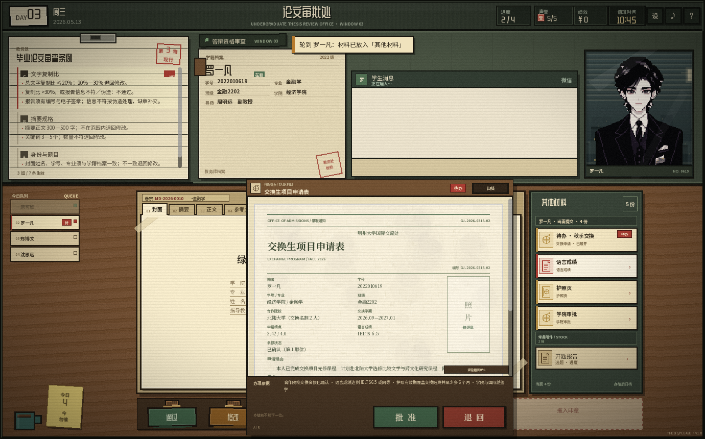
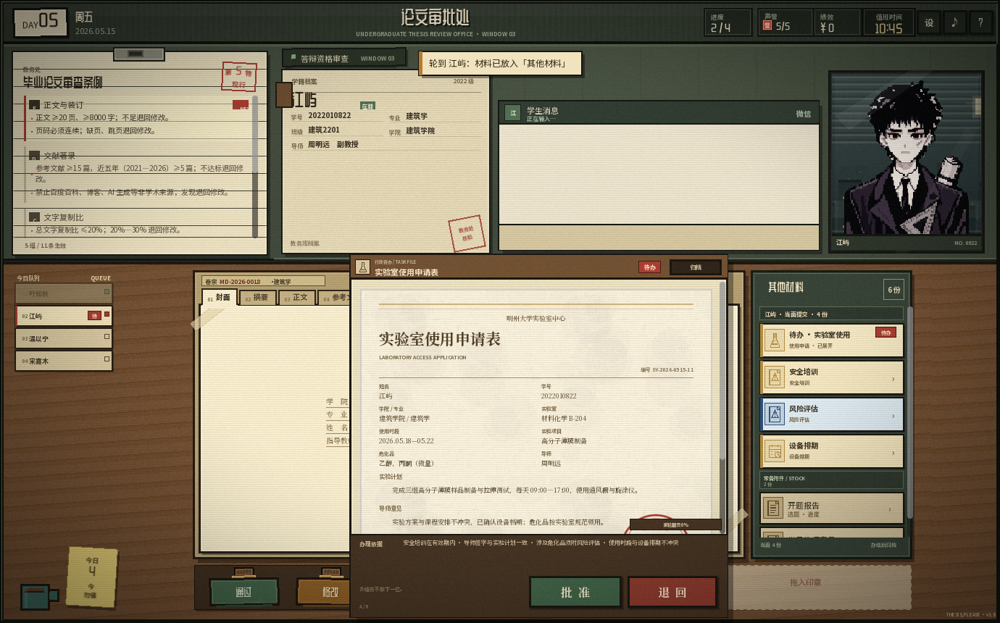
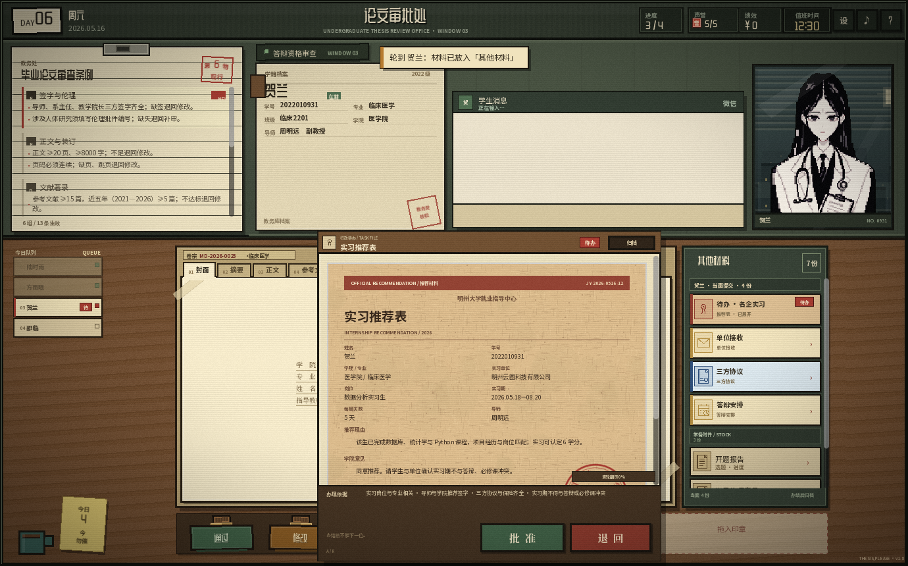

# v1.13 新事件：交换生、实验室使用、实习推荐

这三个事件已经作为正式待办包接入关卡队列；每个事件都绑定到具体学生，轮到该学生时材料进入“其他材料”，办结后才能进入下一位。

## 1. 交换生项目 · D3 第 2 位

- 任务 id：`exchange-d3-exchange`
- 结论：**退回**
- 关键缺陷：护照有效期至 2026.10.15，交换结束为 2027.01.20，且不足结束后 6 个月。
- 办理依据：
  - 合作院校交换名额已确认；
  - IELTS 6.5 或同等；
  - 护照有效期覆盖交换结束并至少多 6 个月；
  - 学院与国际处签字。

| 材料 | style | 核对点 |
|---|---|---|
| 交换生项目申请表 | `admission` | 北陆大学名额、交换学期、GPA 3.42、IELTS 6.5 |
| IELTS 语言成绩证明 | `sealed` | 总分 6.5、单项不低于 6.0 |
| 护照资料页 | `passport` | 有效期 2026.10.15（不足） |
| 学院审批表 | `certificate` | 学分认定与学院签字 |

## 2. 实验室使用申请 · D5 第 2 位

- 任务 id：`lab-d5-access`
- 结论：**批准**
- 关键点：安全培训有效期至 2027.03.31，风险评估与设备排期齐全。
- 办理依据：
  - 安全培训在有效期内；
  - 导师签字与实验计划一致；
  - 危化品附风险评估；
  - 使用时段与设备排期不冲突。

| 材料 | style | 核对点 |
|---|---|---|
| 实验室使用申请表 | `certificate` | 材料化学 B-204、05.18—05.22、高分子薄膜 |
| 安全培训合格证 | `id_card` | 化学安全二级、有效期至 2027.03.31 |
| 实验风险评估表 | `carbonless` | 乙醇/丙酮、通风橱、有机废液 |
| 设备使用排期卡 | `index_card` | 旋涂仪/拉伸试验机，无冲突 |

## 3. 名企实习推荐 · D6 第 3 位

- 任务 id：`internship-d6-recommend`
- 结论：**退回**
- 关键缺陷：实习期 2026.05.18—08.20 与 06.10 毕业论文答辩、周三必修课冲突。
- 办理依据：
  - 岗位与专业相关；
  - 导师/学院推荐签字；
  - 三方协议与保险齐全；
  - 实习期不得与答辩或必修课冲突。

| 材料 | style | 核对点 |
|---|---|---|
| 实习推荐表 | `cardstock` | 数据分析实习生、6 学分、导师签字 |
| 单位接收函 | `admission` | 05.18—08.20、每周 5 天、实习责任险 |
| 三方协议 | `carbonless` | 甲方/乙方/丙方、保险、学分认定 |
| 答辩安排 | `index_card` | 06.10 答辩、周三必修课（冲突） |

## 自动化

- `eventcheck`：三个事件的队列位置、材料数量、关键 style、主文件批准/退回按钮。
- `stylecheck`：13 种样式均可渲染。
- `autoweek`：新事件会随一周流程自动办结。
- `content_tools.py check`：12 个待办全部挂接，无重复挂接/未知引用。

## 后续可扩展

- 交换生：签证拒签、保险日期、学分认定不足、语言成绩过期；
- 实验室：安全培训过期、危化品无审批、设备冲突、夜间使用；
- 实习：协议缺保险、岗位与专业不符、实习时长不足、答辩冲突。
